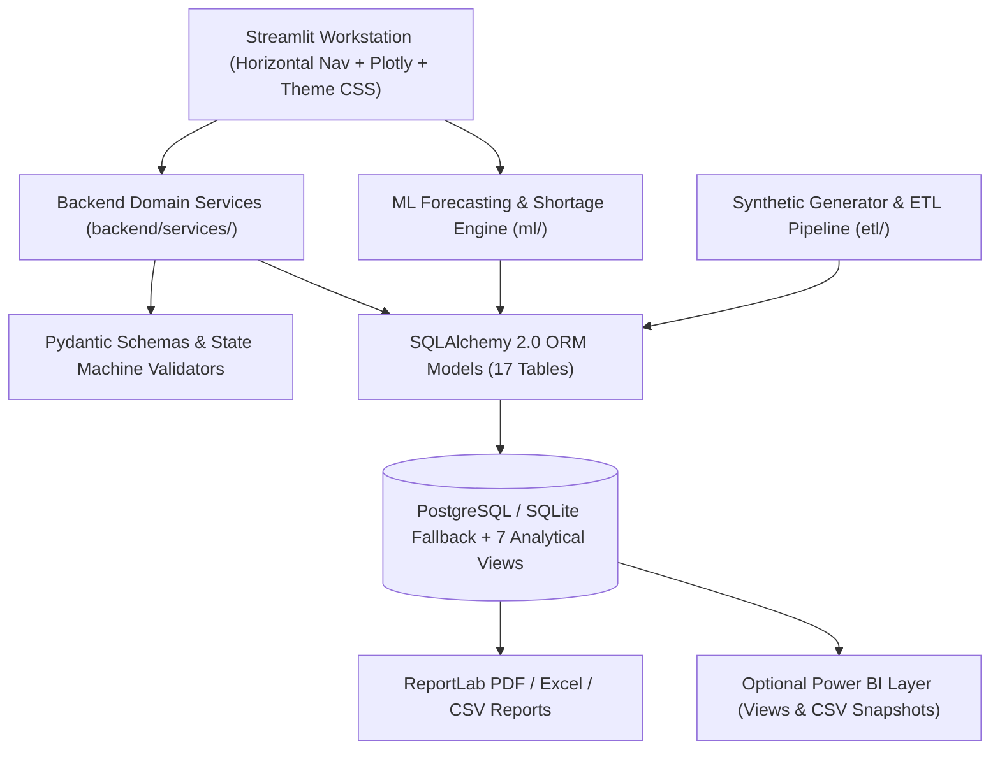

# SANGVAIL — System Architecture

## Architectural Style

SANGVAIL uses a **modular layered Python architecture** avoiding unnecessary microservices while keeping strict separation of concerns across Presentation (`app/`), Domain Services & Validation (`backend/`), Data Engineering (`etl/`), Predictive Analytics (`ml/`), and Relational Persistence (`database/`, `migrations/`).

## Core Layers

| Layer | Directory | Responsibility |
|---|---|---|
| Presentation | `app/` | Horizontal top navigation, login gate, 11 operational modules, restrained Plotly charts, responsive CSS |
| Domain Logic | `backend/services/` | Atomic unit-level inventory reconciliation, donation processing, screening release, request lifecycle, FEFO allocation, expiry sweep/discard, 14-check Data Quality engine, multi-format report builder |
| Validation & Security | `backend/schemas.py`, `backend/validators/`, `backend/auth.py` | Pydantic v2 input validation, inventory & request state machines, bcrypt password hashing, audit logging |
| Relational Persistence | `backend/database.py`, `backend/models.py`, `database/`, `migrations/` | 17 relational tables with foreign keys, unique/check constraints, composite FEFO index, 7 analytical views, Alembic migrations |
| ETL Pipeline | `etl/` | Deterministic 12-month synthetic dataset generator + Extract -> Validate -> Transform -> Load pipeline with structured `ETLRunLog` reporting |
| ML & Planning | `ml/` | Strict chronological evaluation (Seasonal Naive, Moving Average, Random Forest), uncertainty intervals, model persistence, transparent rules-based shortage planning |

## Database Entity Relationships

- `donors (1) -> (N) donations (1) -> (N) blood_units`
- `blood_units (1) -> (N) screening_records`
- `blood_units (1) -> (N) inventory_transactions`
- `hospitals (1) -> (N) blood_requests (1) -> (N) blood_allocations (N) <- (1) blood_units`
- `blood_banks x blood_groups x blood_components -> stock_thresholds`
- `blood_groups x blood_components -> forecast_results`
- `users (1) -> (N) audit_logs`, plus `app_settings` and `etl_run_logs`.
